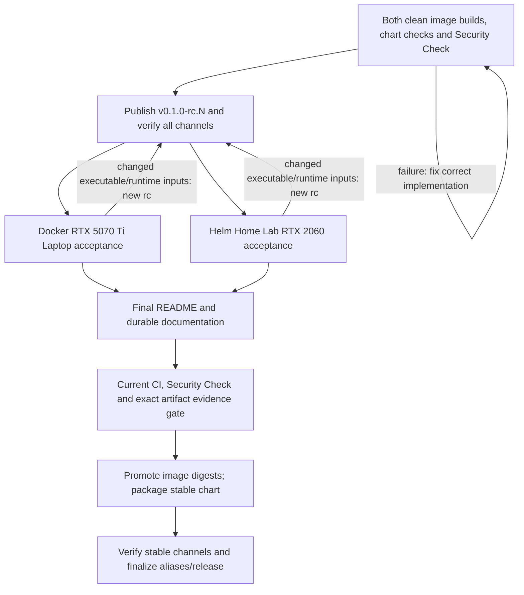
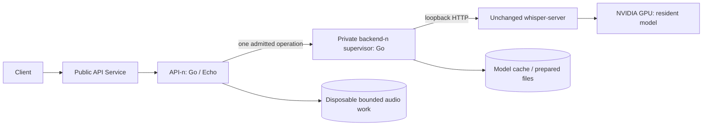

# Resident V1 implementation plan

Status: planning complete; I01/I02/I03/C01 complete on 2026-10-11. Hosted main and pull_request checks passed; intentional failure blocked the test PR, and Bootstrap checks is required on main. Runtime implementation not started.
Depth: Deep. Profiles: core, backend, operations, security.
Current authorization: C01 only. The user explicitly authorized initial public source commit/push and test PR with `ok`; scoped workflow/settings writes and CI execution are covered. C01 is complete; stop before F01 or later packets. No artifact publication, deployment or PR merge is authorized.

## Reviewed inputs and readiness

- source_version: `626342ee71f5181542a95897369aa7cfa0c2982a7e3a9e599df437e5f3b7df90`
- specification_version: `25616a15c355593138f32986719f830ca2ce2fac6cf1e9e1a2c03209fdd33c02`
- review_ref: `8af11f7b-6523-4d43-926e-bf5ff1d3d1b2`
- Source: [spec.md](../spec.md), Approved, 31 requirements. Fresh full independent review covers all 91 items, including the Codex project-only amendment and final whole-specification consistency. The author approval transition is checkpointed through workflow MCP.
- Scope proposal revision 8 remains explicitly confirmed: Deep/core/backend/operations/security, the same three artifact names and per-IP replaceable in-memory storage. The user explicitly added protocol-neutral service errors and HTTP-only adaptation. No additional protocol, package, profile or pending user decision is introduced. Fresh full review passed before author-made Approved state.
- Confirmed manifest: core/contracts.yaml, contracts/openapi.yaml, quality/scenarios.yaml. Query manifest/decisions through workflow MCP; never parse or hand-edit them.
- [Core configuration/lifecycle contract](../core/contracts.yaml), [public OpenAPI](../contracts/openapi.yaml), [quality scenarios](../quality/scenarios.yaml) are consistent planning contracts; their runtime behavior has not been implemented.

Before each explicit packet invocation, reopen workflow state, verify confirmed scope and the pinned Approved specification/review, and read exact linked requirements through MCP. Recheck the aggregate source version before completion. Source drift returns affected work to specification/planning. I01 owns local bootstrap; later packets require a usable Git worktree and passing prerequisites.

## Evidence and constraints

I01/I02/I03 are complete: the local Git worktree, Go module, exclusion/tool metadata, community files, scoped public repository/channel setup, Codex project rules/skills/checker and private Home Lab preparation exist. See the current [handoff](handoff.md) and [agent setup](../../../agent-setup.md) for checks and limits. No runtime code, application tests, Dockerfiles, Compose file, chart or published release artifacts exist. Target root has no .codegraph directory; recheck before code lookup during execution. No remaining packet is executed or repository/registry setting changed by I03 completion.

Settled choices: Go + Echo, separate API/backend Pods, one fixed Resident model, unchanged C++ HTTP server, two images and one chart. Use Go 1.26.5 baseline and Echo v5.4.0 (requires Go >=1.25); the local Go/Helm observation does not establish container or cluster compatibility. Decode in the API with FFmpeg 9.0.2, CUDA 12.8 baseline for the native image. Resolve actual immutable toolchain/base-image/source identities in P05; never invent digests.

Verified primary evidence:

- [Pinned native server](https://github.com/OpenWhispr/whisper.cpp/blob/6ac14546046ffb17d144a08bcad65337e535cf5/examples/server/server.cpp): actual Git blob `b87ef27375fd614d9e7c9698ecda94b03e548eb6`, 1298 lines. Startup loads the model at 717–726; /inference locks at 817–819 and copies startup parameters at 832–833; cancellation callback is 983–988; /load is 1163–1199; /health reads atomic state without the inference mutex at 1206–1215. Earlier web-extracted line numbers were inconsistent; use the actual blob.
- [GPU initialization and CPU fallback](https://github.com/OpenWhispr/whisper.cpp/blob/6ac14546046ffb17d144a08bcad65337e535cf5/src/whisper.cpp#L1290-L1358): native health alone cannot exclude CPU fallback. The supervisor requires positive CUDA backend/model-buffer startup facts (allocation diagnostic at 1854–1857), checks GPU health and fails closed. This still needs actual transcription on both GPUs.
- [Source CUDA architecture policy](https://github.com/OpenWhispr/whisper.cpp/blob/6ac14546046ffb17d144a08bcad65337e535cf5/ggml/src/ggml-cuda/CMakeLists.txt#L8-L55): GPU-free build with native detection disabled; preserve the source's 12.8 architecture set, including Turing and Blackwell. CUDA >=12.9 adds 121a; CUDA 13 removes legacy 50/61/70, so publish variants/coverage if changing toolchains.
- [Echo v5.4.0 module](https://github.com/labstack/echo/blob/v5.4.0/go.mod), [pooled Context](https://github.com/labstack/echo/blob/v5.4.0/echo.go) and [body limit](https://github.com/labstack/echo/blob/v5.4.0/middleware/body_limit.go): do not retain Echo Context/ResponseWriter in the queue; own request data and wait in the handler.
- [StatefulSet identity/replacement](https://kubernetes.io/docs/concepts/workloads/controllers/statefulset/) and [NetworkPolicy enforcement](https://kubernetes.io/docs/concepts/services-networking/network-policies/): ordinal pairing and non-surge replacement fit the required ownership/single-GPU rollout; rendered policy alone does not prove CNI isolation.
- [FFmpeg release](https://ffmpeg.org/download.html), [protocol allowlist/cache](https://ffmpeg.org/ffmpeg-protocols.html#cache), [9.0.2 cache](https://github.com/FFmpeg/FFmpeg/blob/n9.0.2/libavformat/cache.c#L85-L99) and [temporary files](https://github.com/FFmpeg/FFmpeg/blob/n9.0.2/libavutil/file_open.c#L115-L146): a bounded stdin plus cache/pipe supports seeking without enabling file/network URL protocols; /tmp needs isolated disposable storage. Verify actual decoder behavior in P03/P05.
- Bootstrap model source revision, size and SHA256 were checked through Hugging Face metadata; no model was downloaded in planning. Core contract pins these values.

These are source facts and proposed integration choices. No Docker build, inference, cluster deployment or benchmark has passed yet.

## Initialization, repository and agent setup

Initialization is split into I01 local Git/tooling, I02 public repository/community settings and I03 portable agent setup. C01 establishes early CI; C02 completes build/release automation after images/chart exist. Keep P01–P09 IDs stable so existing runtime coverage remains traceable.

Selected identity is `swimmwatch/openwhispr-whisper-server`. I02 verified GitHub/Docker Hub ownership, scoped write access and public repository metadata; its current evidence is in [handoff.md](handoff.md). GHCR package visibility and actual anonymous artifact pulls remain first-publication checks in C02/R01. Own code/chart license is Apache-2.0; actual third-party redistribution requirements are checked before distribution.

| Stage | Proposed artifacts/settings | Boundary and verification |
| --- | --- | --- |
| I01 | Git main branch; Go module `github.com/swimmwatch/openwhispr-whisper-server`; go.mod/go.sum; .editorconfig, .gitattributes, .gitignore, initial .dockerignore; tools/version manifest and local check commands | Record actual tool versions/immutable sources, LF/text/binary handling and build exclusions. Do not create fake service packages/tests to make an empty module pass. A fresh checkout resolves/checks without a GPU or maintainer secrets. |
| I02 | Public GitHub repo, LICENSE, CONTRIBUTING.md, CODE_OF_CONDUCT.md, SECURITY.md, SUPPORT.md, CHANGELOG.md, THIRD_PARTY_NOTICES.md; .github issue/PR templates, CODEOWNERS, dependency update settings | Apache-2.0 applies to own work only. Enable private vulnerability reporting, set a verified private conduct/security contact route, public package channels and main protections against force-push/deletion. Require real CI check names once C01/C02 create them; do not require an unavailable reviewer in a one-maintainer project. Keep final README for P09. |
| I03 | Root AGENTS.md with Go/Docker/Helm architecture rules and a private-context pointer, two project-local Codex skills, reviewed useful project settings, tools/check_agents.py, docs/agent-setup.md and ignored .local/homelab preparation | Portable project rules and actual Codex discovery, plus this workstation's verified Home Lab login/inventory. No external plugin copy, private cluster identifiers, credentials or transcripts in tracked files; no global trust/provider/model changes. RTK is agent tooling, not a service or CI runtime dependency. |
| C01 | Bootstrap GitHub Actions and stable required-check names | Validate real existing module/config/contracts/tools on hosted Linux; no secret access/publishing, privileged runner or placeholder success. C02 adds the actual build/race/Helm/security release gates. |

The user narrowed I03 on 2026-10-11 through Request User Input to Codex project files only. gpu-acceptance and release-verification live under .agents/skills, refer to their owning project harnesses and clearly report planned/unavailable commands. External developer plugins, including engineer-agent-workflows, remain separately installed operator tools; I03 neither copies them nor requires their publication. An explicitly invoked external workflow still follows its own matching manual/MCP prerequisites. CodeGraph is used first only when .codegraph exists; index creation remains separately requested. Context7/GitHub connections are documented only with scoped non-secret settings and actual availability; service/builds do not depend on agent connectors.

AGENTS.md is the only project instruction source. No second client adapter, external workflow snapshot or speculative MCP/configuration file is part of I03. The reusable structural check verifies source references, local skill metadata/containment, reviewed Codex config shapes and absence of personal paths/secrets/global controls. Fresh native Codex discovery and policy comprehension remain required; file presence alone is insufficient.

Earlier bundle/second-client checks are cancelled by this explicit scope change, not reported as passed. No source/cache copying or external publication is needed to finish I03. Runtime, security, release and GPU acceptance requirements remain unchanged.

I03 records actual Codex versions and native project-session discovery of AGENTS.md and .agents/skills; installation documentation alone is not acceptance. Configurations remain limited to useful reviewed project settings, with no model/provider/trust/approval overrides. Tested commands and safe observations belong in docs/agent-setup.md.

## Agent architecture policy

I03 must include explicit Go, Docker/Compose and Helm/Kubernetes rules in the
canonical root AGENTS.md for Codex. The rule checklist and checked
primary sources are in [I03 architecture policy](init_03_agent_tooling.md#architecture-policy-for-agentsmd).
Keep rules actionable and reference authoritative architecture/configuration
contracts rather than copying defaults or inventing another policy document.

The user requested three GPT-6 Luna research scouts. Their read-only findings
were validated against official Go/Docker/Helm/Kubernetes documentation and this
Approved specification. Prometheus, upstream whisper.cpp and kube-prometheus-stack
serve as concrete references, not architectures to clone. Community project-layout
is not an official Go standard. Preserve the selected Go packages/toolchains,
unchanged native server, paired separate Pods, GPU coverage and release boundaries.

| Rule group | I03 policy/discovery evidence | Existing implementation enforcement |
| --- | --- | --- |
| Go G01–G06 | Codex locates layers/ports, error adaptation, context/lifecycle and approved-package rules | F01 import/config/error/middleware checks; P01–P04 actual runtime wiring |
| Docker D01–D06 | Codex explains image/source boundaries, CUDA coverage, permissions, signals, storage and private Compose wiring | P05 builds/image/Compose checks; C02 security/build gates; P07 actual GPU/lifecycle |
| Helm H01–H06 | Codex explains chart conventions, stable selectors, ordinal pairing, GPU/rollout, configuration parity and retained storage | P06 values/render/schema/package checks; C02 security gates; P08 actual cluster/GPU |

I03 checks canonical rule references and representative read-only explanations
after real client discovery. It does not create runtime artifacts or run later
packets' checks. Text matching, a successful agent session or rendered YAML cannot
establish runtime architecture compliance. The existing owners and acceptance
gates remain unchanged; no new packet, tool dependency or product behavior is added.

## Private Home Lab context

The user requested collection and reusable local access for an educational Home
Lab Kubernetes test cluster. Add this preparation to I03, with the exact artifact,
inventory and access checklist in [I03 local preparation](init_03_agent_tooling.md#local-home-lab-preparation).
Keep .local/homelab/README.md for login/re-login and agent instructions,
cluster.yaml for the private observed inventory/target choices, kubeconfig for
the dedicated confirmed cluster/context, and access/ only for necessary separate
authentication material. Permissions are 0700 for private directories and 0600
for credential files. .gitignore and .dockerignore already exclude .local.

Collect actual connection/network prerequisites, Kubernetes/Helm/runtime versions,
RTX 2060/driver/VRAM and GPU allocation, device plugin/runtime class, CNI,
storage/claim ownership and any existing Ingress prerequisites. Record observation
time, source, access scope, renewal procedure and unknowns. Save confirmed test
namespace/release choices; pending choices must not become an arbitrary default.
I03 checks read-only login/connectivity/permissions and Codex's ability to
resolve the local runbook; no deployment or infrastructure change is performed.

AGENTS.md and gpu-acceptance refer to the generic local path and explicit
kubeconfig/context selection, with no copied endpoints, accounts, topology or
credentials. Portable agent discovery, public builds and CI do not depend on
private access. I03 stores actual private inventory/login evidence locally; P08 refreshes it before its separately authorized runtime acceptance.

P08 consumes and refreshes this context before the target gate and before mutations:
recheck credentials, permissions, versions and GPU/CNI/storage state. Reuse recorded
access/authorization and request only undiscoverable missing/expired login steps
or genuinely unconfirmed target decisions. Private target values and full evidence
stay in .local; public qualification reports contain outcomes/artifact identities
without private inventory/access dumps. Existing P08 test-release limits and cache
retention remain in force; cluster access is not automatic deployment authority.

## Security Check

The security profile already requires dependency/image evidence under REQ-026; this draft makes its tools and release conditions concrete without adding a new product surface. Authoritative policy: core/contracts.yaml delivery.security_checks. C01 adds current-source secret checks; C02 owns the complete required Security Check; R01/R02 consume exact evidence. No scanner is installed or executed by planning.

| Surface | Selected checks | Required evidence |
| --- | --- | --- |
| Go | [govulncheck](https://pkg.go.dev/golang.org/x/vuln/cmd/govulncheck) for known reachable vulnerabilities; [gosec](https://github.com/securego/gosec) for unsafe source constructs | Both application/supervisor entry points and owned packages under actual release toolchain/build settings; unresolved source issues fail |
| Docker | [Hadolint](https://github.com/hadolint/hadolint) for both Dockerfiles/RUN shell; [Trivy](https://trivy.dev/docs/latest/scanner/misconfiguration/) for configuration plus image scans | Both actual built images by immutable identity, detected OS/Go/dependency packages, source-component reconciliation, secrets in files/configuration/history |
| Helm/Kubernetes | [Trivy Helm scanning](https://trivy.dev/docs/latest/coverage/iac/helm/) with custom values plus actual helm template output | Default and P06 supported values matrix, extracted packaged chart, non-root/privilege/token/GPU/network invariants |
| Project source/secrets | [Trivy secret scanning](https://trivy.dev/docs/latest/scanner/secret/) | Current project source and extracted chart/image contents; sanitized reports, no real credential test data |

Run these checks for PR/main changes and before candidate/stable publication. Security Check is a required aggregate result in C02; failed, skipped, missing, unsupported or stale required scans cannot pass. The initial empty-module bootstrap explicitly has narrower coverage, not a complete security badge.

HIGH/CRITICAL Trivy vulnerabilities/misconfigurations block; known unfixed findings are included. All secret findings, unresolved gosec findings and reachable govulncheck findings block independently of that severity filter. Go's database does not use the same HIGH/CRITICAL scale. Exceptions only cover demonstrated false positives/non-applicability, scoped to rule/advisory and path/package with rationale, maintainer and expiry; no blanket suppression or acceptance of a known applicable blocking flaw. Low/medium findings remain visible for triage.

Scanner/action versions are pinned and verified against the Go baseline during initialization/CI setup; vulnerability databases/rules are refreshed and identified for release checks. Reports bind source SHA, image manifest digest, chart archive SHA256 and values matrix to scan time/configuration. An empty image/package report does not prove custom whisper.cpp/FFmpeg/CUDA code is covered: reconcile actual components/advisories and disclose gaps.

govulncheck machine-readable formats can exit zero despite findings; use its text-mode failure status or a tested parser, not report-upload success. Secret reports/snippets are redacted before public artifacts. Fork PRs retain read-only hosted execution; report upload must not grant publishing rights. Stable promotion rescans accepted images without rebuilding and checks the stable chart's new bytes; new database findings block promotion while runtime dependency fixes require a new RC. Static scans supplement the existing actual process/CNI/GPU/privacy tests.

## CI/CD and public release flow

C02 uses GitHub Actions with full action-SHA pins, job-specific permissions and hosted Linux amd64 builds. Go formatting/vet/tests/race and contract checks, actionlint, Dockerfile lint, both actual clean builds, image inventory/security/license checks, Helm lint/values/render/Kubernetes-schema/package checks and affected documentation/settings checks are required. Reuse the project checks from earlier packets. A bootstrap-only CI pass is not the complete release pipeline. Model download/cache behavior is tested with controlled fixtures; real acceptance uses pinned public audio and the identified GPUs.

Docker packaging retains multi-stage builds, the smallest sufficient compatible runtime images, digest/source pins, .dockerignore and non-root behavior. Reviewed dependency/base/action update PRs prevent pins from freezing security maintenance. BuildKit SBOM/provenance must survive publication and be inspected on pulled manifests. A release clean build cannot depend on untrusted PR cache writes; no real secret is a build arg. Sources: [Docker build guidance](https://docs.docker.com/build/building/best-practices/), [attestations](https://docs.docker.com/build/metadata/attestations/), [multi-registry publication](https://docs.docker.com/build/ci/github-actions/push-multi-registries/).

Release inventory owns names/version mapping under core/contracts.yaml delivery, not repeated mutable constants in scripts. Images are openwhispr-whisper-server-api and openwhispr-whisper-server-backend in GHCR and Docker Hub. Chart remains whisper-server at `oci://ghcr.io/swimmwatch/charts/whisper-server` and the Pages Helm endpoint. Build/select each image once and preserve its manifests across registries. Package the chart once per version, upload identical tgz bytes to OCI/Pages, and record the archive SHA256 separately from the OCI manifest digest. Helm OCI push omits chart name/tag in its destination; the archive supplies them. Merge the old classic index, serialize publication and keep old versions/checksums. Validate these commands on the actual pinned Helm 3/4 tools; the current OCI page warns its Helm 4 update is incomplete. Sources: [Helm OCI](https://helm.sh/docs/topics/registries/), [classic repository](https://helm.sh/docs/topics/chart_repository/), [values/schema/package guidance](https://docs.helm.sh/docs/topics/charts/).

Untrusted PRs use pull_request with read-only contents access, no release secrets, cluster credentials or privileged self-hosted runner. Do not check out/execute untrusted PR code under pull_request_target. Trusted publisher jobs receive only necessary packages/content/Pages permissions. GHCR uses repository-linked job-scoped GITHUB_TOKEN; Docker Hub uses a scoped protected token. Package visibility is checked independently of repository visibility through anonymous pulls. Sources: [GitHub Actions security](https://docs.github.com/en/actions/reference/security/secure-use), [fork permissions](https://docs.github.com/en/actions/reference/workflows-and-actions/events-that-trigger-workflows), [GHCR permissions/visibility](https://docs.github.com/en/packages/working-with-a-github-packages-registry/working-with-the-container-registry).



R01 creates the first candidate, for example v0.1.0-rc.1, only after all non-GPU build/check jobs pass. A build failure is fixed and the full affected build pipeline rerun until successful. Failure after publishing changed bytes requires rc.2, rc.3 and so on; never overwrite rc.1. R01 finishes with a published but GPU-unqualified candidate. P07/P08 then test pulled exact candidate identities. Fixes in those packets invalidate affected evidence and return to a new R01 candidate before acceptance can complete. Both suites are required; absent cluster/GPU access is not a pass.

P09 prepares root/chart READMEs and final developer/operator/agent/release documents after real acceptance. README is the last documentation stage before stable release, rather than an early scaffold. R02 verifies final-source CI, candidate/build-source inventory and report identities. Documentation-only changes can reuse runtime evidence only when verified build/runtime inputs are unchanged. Preserve accepted executable image digests; do not silently rebuild them under stable tags or change their original build provenance. Stable chart version/appVersion/alias metadata necessarily creates a new archive: validate the diff, rendering/config equivalence, its new checksum and pulls from both chart channels. Any changed rendered/runtime behavior renews affected target acceptance.

Versioned stable artifacts are verified first; stable/latest aliases and GitHub latest designation are finalized last. Cross-registry publication is not atomic: a partial failure is recorded, leaves completion false, and recovery preserves prior stable versions and restores prior aliases when needed. Gate tests reject missing/failed/skipped required jobs, a missing GPU report, source/digest drift, unfinished docs or a failed channel. Credentials go only through protected settings, never Markdown. No kube credentials or automatic Home Lab deployment are configured. Sources: [GitHub releases](https://docs.github.com/en/repositories/releasing-projects-on-github/managing-releases-in-a-repository), [community files](https://docs.github.com/en/communities/setting-up-your-project-for-healthy-contributions/about-community-profiles-for-public-repositories), [private vulnerability reporting](https://docs.github.com/en/code-security/how-tos/report-and-fix-vulnerabilities/configure-vulnerability-reporting/configure-for-a-repository).


## Go foundation decisions

Use the [official server-module layout guidance](https://go.dev/doc/modules/layout), [Effective Go](https://go.dev/doc/effective_go) and [Go Code Review Comments](https://go.dev/wiki/CodeReviewComments). Go recommends cmd/internal for server projects; the inward dependency rule below is this project's Clean Architecture choice, not an official universal directory standard.

```text
cmd/api, cmd/backend                 explicit assembly and shutdown
internal/domain                     plain types and invariant rules
internal/application/transcription  use cases, FIFO and consumer-owned ports
internal/adapter/{httpapi,audio,upstream,models,backend}
                                    Echo, FFmpeg, HTTP, files and native processes
internal/platform/{config,logging}  startup settings and safe diagnostics
```

Do not create empty scaffolding. Keep package names simple, context first for blocking operations, errors wrapped for errors.Is/As without content leakage, goroutine ownership/cancellation explicit and dependencies passed through constructors. Tests live beside packages; only external processes/GPU/chart suites need separate integration/acceptance directories. F01 adds a go list based import-boundary check; introduce no DI/code-generation/repository framework.

The package/default/identity authority is core/contracts.yaml go_foundation/observability/rate_limit/configuration. Selected sources checked on 2026-10-10:

| Concern | Selected implementation | Integration constraint |
| --- | --- | --- |
| Logging | [standard log/slog](https://pkg.go.dev/log/slog) JSONHandler | Shared safe allowlist; no added Zap/Zerolog dependency; validated level before serving |
| HTTP correlation/requests/recovery | [Echo v5.4.0 middleware](https://github.com/labstack/echo/tree/v5.4.0/middleware) | Validate/replace inbound ID before RequestID/RequestLogger; safe Recover/error handler; capture final status without raw error/URI logging |
| Rate limit | [Echo v5.4.0 RateLimiterStore](https://github.com/labstack/echo/blob/v5.4.0/middleware/rate_limiter.go) and its memory store | Existing replaceable store interface; TTL/burst/rate, 429 versus store-error 503; no Redis implementation in V1 |
| Client IP | [Echo v5.4.0 IP extractors](https://github.com/labstack/echo/blob/v5.4.0/ip.go) with net/netip normalization | Direct by default; explicitly trusted XFF CIDRs only, all implicit trust disabled |
| Config | [Koanf v2.3.8](https://github.com/knadh/koanf/releases/tag/v2.3.8) with providers and standard flag parsing | Explicit flag presence, strict source validation/duplicate JSON precheck and collection replacement; no hot reload; verify provider versions |
| Validation | [validator/v10 v10.30.5](https://github.com/go-playground/validator/releases/tag/v10.30.5) | WithRequiredStructEnabled on startup DTOs; library requires Go >=1.26.0, satisfied by 1.26.5 baseline; domain/audio semantic rules remain explicit |
| Errors | [standard Go errors](https://pkg.go.dev/errors) and [wrapping guidance](https://go.dev/blog/go1.13-errors) | Small typed semantic failure and Error/Unwrap; errors.Is/As and %w preserve identity; HTTP metadata belongs only to the HTTP adapter |

Context7 supplied Koanf v2.3.7 layering examples; current v2.3.8 source/release closes that version gap. Available Echo Context7 documentation was v4, so v5 behavior was checked in pinned primary source. Koanf StrictMerge is not duplicate/unknown-key validation, Echo RequestID alone accepts arbitrary IDs, and default request/panic logging can expose unsafe values: thin integration must enforce the spec. Verify actual compatible module graph/checksums/licenses/security at F01; nothing is installed during planning.

The chosen rate store has idle expiry, not a hard active-IP capacity bound. Test cleanup after churn and document its modest-load scope. Per-IP quotas are local to each Pod; restarts refill/reset them and clients behind NAT share an address. An enabled Ingress must document/set trusted proxy CIDRs and sanitize its external forwarded headers; chart templates cannot infer them safely. Quotas do not replace body/staging/FIFO/GPU bounds.

### Service errors and HTTP mapping

Authority: core/contracts.yaml go_foundation.error_contract for internal format and contracts/openapi.yaml x-error-registry/ErrorEnvelope/Error for HTTP presentation. Keep two representations:

```text
Service/ports: Failure { Kind, optional Field, optional Cause }
                   -> errors.Is/As in the HTTP adapter
HTTP boundary: HTTPFailure { Status, safe envelope, allowed headers }
```

Failure/FailureKind belong to internal/domain. Kind expresses a semantic cause rather than an HTTP status; Field identifies a logical input, and Cause preserves an underlying Go error through Unwrap. No HTTP/Echo values, JSON tags, public message/type or response headers belong in the inner type. For example, unknown_model maps to public model_not_found, audio_too_long to audio_duration_limit and deadline_exceeded to operation_timeout. Ports return ordinary Go error values; audio/upstream/backend adapters classify their external errors before crossing inward. Application code does not inspect backend statuses or parse error strings.

MapFailure/HTTPFailure belong to internal/adapter/httpapi. One mapping owns existing status/code/type, fixed safe message, allowed param and response headers. The existing JSON envelope remains {error: {message, type, param, code}}; HTTP status remains the response status, not a service field. A direct or wrapped queue_full failure yields 429/rate_limit_error/queue_full; unclassified/unknown failures yield safe 500/api_error/internal_error. Absent or unknown logical Field maps to null, never arbitrary user text. Effective request ID is retained in the header; dynamic Retry-After applies only to HTTP rate-limit rejection. Health retains its specific schema. Do not serialize Failure or Cause or expose Error() text to callers/logs. Only owning handlers write responses; committed/disconnected responses are not written again, and deadline/shutdown recovery keeps existing semantics.

F01 creates the types, mapper and fixture checks before transcription. P02/P03 convert native/decoder/private-HTTP failures and wire real handlers; P04 produces and transports semantic queue/deadline/readiness/shutdown failures; P09 documents the verified boundary. Q-ERRORS covers direct/wrapped identity, the whole public registry, private marker exclusion, field mapping, health and response ownership. Implement only HTTP adaptation; no generic transport framework, extra error dependency, alternate protocol or new endpoint.

## Runtime and deployment



Two StatefulSets maintain matching ordinals. A per-ordinal backend Service selects only backend-n; API-n resolves only that Service. Per-ordinal NetworkPolicy permits this pair. The API Service can balance across APIs; there is no pooled inference backend. Native Whisper listens only on loopback inside its backend Pod.

API owns bounded staging and one FIFO, plus request resources; supervisor owns one native subprocess, model provisioning and recovery. Native stdout/stderr never pass raw into container logs. Whitelisted bounded startup diagnostics establish CUDA initialization/allocation; real GPU tests establish inference and stability.

On active cancellation, deadline or uncertain transport state, supervisor becomes unready and stops/kills/reaps its native process group before any new inference. Ordinary success preserves the process. Reload may take longer than the 10-second cleanup bound; safe stop/cleanup must finish within it, and readiness stays false during reload. Backend also enforces remaining deadline after API death. A dropped proxy socket or native /health=200 alone never releases the next operation.

Independent controller updates can temporarily mismatch configuration/generation. Private health/inference carry protocol, canonical model/inference fingerprint and native generation; mismatch fails before execution, without retrying a submitted request. Ordered replacement permits downtime and needs no spare GPU. Shutdown drains active work for 30 seconds, then allows 10 seconds for stop/cleanup; chart grace defaults to 45 seconds.

## Docker Compose delivery and examples

This clarifies approved standalone operation under REQ-015. REQ-004/005/014/017/019/027
cover model sources, cache, readiness, lifecycle, privacy and registry selection.
No new execution mode or deployment packet is introduced. P05 owns
`deploy/compose.yaml` and non-secret `deploy/compose.env.example`; P07 owns real
GPU example acceptance; P09 owns the final Compose section in `docs/operations.md`
and a linked README quickstart. Reuse one Compose definition with validated inputs
rather than copying a full YAML stack into every recipe.

The topology is one API container and one backend supervisor/native container.
Only the public API port is published, initially on loopback for local use;
external exposure is an explicit operator choice because V1 has no authentication.
Only the backend receives one selected NVIDIA GPU. Its supervisor is on the
dedicated Compose network; native HTTP remains on backend-container loopback.
Model download needs permitted outbound access; a private backend does not imply
an air-gapped network. Prepared mounts are read-only, cache is persistent, and
transient work uses separate bounded disposable storage.

| Planned recipe | Inputs and expected outcome | Verification owner |
| --- | --- | --- |
| Published GHCR images | Both immutable release image references, one GPU, fixed Resident model and persistent cache; public transcription after readiness | P05 input/render checks; R01 pulls; P07 runtime; P09 reader commands |
| Published Docker Hub images | Override both image references from the same release inventory; equivalent behavior without rebuilding | P05 input/render checks; R01 pulls; P07 smoke; P09 reader commands |
| Local image builds | GPU-free builds of both Dockerfiles followed by the same stack with explicit local images; GPU required only at runtime | P05 builds; P07 wiring; P09 developer recipe |
| Prepared file or populated cache offline | Explicit paths and UID permissions; read-only prepared mount; zero model-source requests, no implicit download fallback | P05 mounts; P07 Q-CACHE; P09 offline recipe |
| Restart, configuration change and stop | Cache reuse; recreate the pair for compatible changed settings with documented downtime; normal down preserves operator cache | P05 lifecycle settings; P07 runtime/cache proof; P09 operator recipe |

Every recipe states its working directory, environment/configuration file paths,
effective image references, GPU selector and model/cache permissions. Commands
cover config validation, pull or build, start, public `/health/live` and
`/health/ready`, multipart transcription, safe status/log inspection and stop.
Compose `.env` interpolation is distinct from application settings injection;
show how values reach both services using the existing configuration authority.
`restart` does not apply changed environment/configuration: document the tested
recreation command. Normal teardown must not use `down --volumes` or delete model
files. Both service stop grace periods meet the configured shutdown/cleanup
budget; the baseline is at least 45 seconds.

Record tested Docker Engine/Compose plugin/NVIDIA runtime versions in P05/P07.
Planning observed Compose 5.6.0 locally; this is not runtime compatibility evidence.
Use GPU reservations with `capabilities: [gpu]` and either one selected `device_ids`
entry or `count: 1`, never both. Container creation/startup ordering does not
establish service readiness; public probes remain authoritative during model
provisioning, inference, backend failure and reload. Primary references checked
on 2026-10-11:
[GPU reservations](https://docs.docker.com/compose/how-tos/gpu-support/),
[startup/readiness ordering](https://docs.docker.com/compose/how-tos/startup-order/),
[restart semantics](https://docs.docker.com/reference/cli/docker/compose/restart/),
[volume retention on down](https://docs.docker.com/reference/cli/docker/compose/down/).

## Proposed ownership

All paths/symbols below are proposed, not existing code.

| Unit | Boundary and responsibility | Inputs, outputs, lifecycle/errors | Dependencies, requirements, checks |
| --- | --- | --- | --- |
| U-DOMAIN | internal/domain: ModelID, TranscriptionRequest, Result, Failure | Owned plain data and business invariants; no I/O/framework state | Domain leaf; REQ-031; Q-GOFOUNDATION |
| U-ERRORS | internal/domain Failure/FailureKind; internal/adapter/httpapi MapFailure/HTTPFailure | Semantic typed/wrapped failure -> HTTP status and safe existing envelope/header at the adapter; unknown fallback and response ownership | Domain leaf plus standard errors and HTTP-only adapter; REQ-013/019/029/031; Q-ERRORS |
| U-OBSERVABILITY | internal/platform/logging and HTTP middleware hooks | Validated severity/safe events and request ID -> JSON stdout/context/header; startup to shutdown | slog/Echo callbacks; REQ-019/029; Q-OBSERVABILITY |
| U-ADMISSION | internal/adapter/httpapi/ratelimit | Trusted canonical client IP + injected Echo store -> admit or safe 429/503 before body work | Existing Echo store interface/memory backend; REQ-030/031; Q-RATELIMIT |
| U-CONFIG | internal/platform/config: Load, Validate, CanonicalFingerprint | Layered typed config -> immutable validated startup settings; strict source/type/collection/deferred checks | Koanf/validator + strict integration; REQ-003/006/008/021/031; Q-CONFIG/GOFOUNDATION |
| U-MODELS | internal/adapter/models: Provision, ReadMetadata | Catalog/download/prepared sources -> verified path/capability; lock/partial/atomic publish; absolute provisioning failure | Config, filesystem, HTTPS; REQ-004/005/006; Q-CACHE |
| U-SUPERVISOR | cmd/backend, internal/adapter/backend: Supervisor.Run, ServeInference, StopAndReap | Verified artifact -> native process/model; private HTTP health/inference; cancellation/recovery generation; suppress raw output | Config/models, os/exec, net/http; REQ-006/007/008/011/013/014/017/019; Q-STARTUP/CANCEL/FAILURE |
| U-INPUT | internal/adapter/audio, internal/adapter/httpapi: ReadMultipart, Normalize, ValidateFields | Capped multipart -> owned typed request/canonical WAV; one bounded decoder, streaming sample count; cleanup on every path | Config, FFmpeg subprocess; REQ-012/019; Q-INPUT/BOUNDS/PRIVACY |
| U-UPSTREAM | internal/adapter/upstream: Health, Infer | Typed request/deadline/generation -> transcript or typed safe failure; allowlist fields, bounded reply, no submitted-work retry | net/http, owned request; REQ-006/011/013/014; Q-ISOLATION/FAILURE |
| U-SERVICE | internal/application/transcription: Admit, Shutdown; cmd/api constructor wiring | Valid owned request -> FIFO result; one active +16 waiting; no Echo Context in queue; liveness/readiness/shutdown | Domain/consumer ports and standard library only; REQ-007/011–014/017–019/029/031; Q-FIFO/CANCEL/HEALTH/OBSERVABILITY |
| U-PACKAGING | containers, deploy/compose.yaml, deploy/compose.env.example | Immutable source/config -> two Linux amd64 images and reusable Compose inputs; GPU-free build, UID/mount/signal/private-network contracts | Both binaries/native/decoder; REQ-001/002/015; Q-PACKAGING |
| U-CHART | charts/whisper-server | Valid values -> paired StatefulSets/Services/policies/claims/probes; no surge, retain cache | Packaging/config; REQ-003/016/017/019; Q-CHART/PAIRING/ROLLOUT |
| U-ACCEPTANCE | tests/acceptance and safe evidence reports | Public audio + identified target -> actual GPU, lifecycle/privacy/performance evidence | All units; REQ-002/018/020; real scenarios |
| U-DOCS | README.md, docs/operations.md | Verified behavior/evidence -> reproducible operator/developer guidance, including executable Compose recipes | Completed P07/P08; REQ-001/004/005/015/017/019/020–023/027; reader check |
| U-BOOTSTRAP | Git repository, Go module, tools/version manifest and local checks | Selected identity -> portable checkout/build inputs; one-time bootstrap; reject unsafe exclusions or missing tools | Standard developer tools; REQ-024; I01/Q-INIT |
| U-REPOSITORY | Public GitHub/community/settings | Verified owner -> public repo, policies and private reporting; scoped settings writes/read-back, no collision overwrite | Bootstrap and GitHub API; REQ-024/027; I02/Q-INIT |
| U-AGENTS | Shared AGENTS.md with Go/Docker/Helm rules, client settings, canonical skills and adapters; separate private .local/homelab inputs | Shared rules/pinned bundle -> discovery and policy comprehension; operator access -> local read-only readiness, later refreshed by P08; no private access in tracked settings | I03 portable/policy/local preparation checks; runtime enforcement F01/P05/P06/P07/P08; REQ-025; Q-AGENTS |
| U-CI | .github/workflows, scoped check/release commands | Untrusted/trusted source -> exact check/build reports; no secrets for PRs, minimum publication rights; failures block completion | Runtime/package/chart checks; REQ-024/026–028; C01/C02/Q-CI/RELEASEBUILD |
| U-RELEASE | Release inventory, package/index/alias publication and gate | Fixed candidate/CI/GPU/docs evidence -> published/qualified/stable states; drift/partial failures remain incomplete | CI and manual acceptance; REQ-027/028; R01/R02/Q-DISTRIBUTION/RELEASEGATE |

Dependency direction is HTTP/audio/upstream adapters -> application -> domain. Application owns the consumed Normalizer/InferenceBackend interfaces and does not import their concrete adapters or configuration loader. Native backend/model adapters own OS/HTTP integration; cmd constructors map validated config into typed options and assemble concrete dependencies. Middleware/store contracts stay in the HTTP adapter. Public handlers do not own GPU/model loading. Domain has plain types and invariant rules, without transport/config/framework types; no empty layer packages or generic repositories are required. Use narrow external-boundary test fakes; no generic provider framework, model-manager abstraction or native C++ patches.

Staging credits bound retained uploads plus validated waiting/active requests; reserve before reading large bodies, release on rejection, and never count invalid requests as admitted FIFO operations. A single decoder prevents unbounded decoder processes. Queue admission occurs after validation; FIFO is the admission order, not TCP arrival order. The staging deadline is separately bounded by the configured operation duration. Full capacity returns 429 queue_full without dispatch. FIFO/resource/resident burst suites use an explicit recorded rate override (or disabled limiter) so they reach the intended queue/resource path; dedicated rate suites still check enabled admission/default policy and zero denied work. Do not mistake rate_limit_exceeded for queue_full or weaken either implementation to make an acceptance suite pass.

## Security and privacy boundaries

| Actor / asset | Trust boundary and owner | Positive and negative evidence |
| --- | --- | --- |
| Any reachable client; audio/prompt/transcript | Public multipart enters U-INPUT under bounded validation; U-SERVICE owns transient lifetime. No identity/authentication check is promised. | Valid unauthenticated inference; invalid/path/URL/size inputs never reach model execution (Q-INPUT/BOUNDS). |
| Operator configuration, model sources and image identities | Trusted startup configuration enters U-CONFIG/U-MODELS; download bytes remain untrusted until checksum/publication, prepared files stay read-only. | Verified offline/cache hit and valid download; wrong checksum/missing prepared file cannot publish or fall back (Q-CACHE/PACKAGING). |
| Cluster clients and native lifecycle controls | Released API-n alone reaches supervisor-n through CNI policy; native /load/file serving remain loopback and outside the supervisor allowlist. | Paired inference succeeds; non-paired/direct/mismatched-generation access fails (Q-PAIRING). |
| Native/decoder output, API buffers and work files | U-SUPERVISOR/U-INPUT drain untrusted output without content logs; disposable /tmp is separate from persistent model cache. | Safe diagnostics and cleanup on every terminal path; marker/source-access traps and retained-file mutation are detected (Q-PRIVACY/RESIDENT). |
| GPU/model/process lifetime | U-SUPERVISOR owns one child/model and safe stop/reap; U-SERVICE cannot treat transport closure as GPU completion. | Stable successful reuse; stuck/cancelled child cannot overlap replacement, model allocations release after stop (Q-CANCEL/RESIDENT). |
| Public contributor code / CI credentials | U-CI separates fork PR hosted checks from trusted publisher jobs and cache writes. | Actual PR checks without publish secrets; failed required jobs deny release (Q-CI). |
| Published version / registry and release inventory | U-RELEASE owns immutable bytes, channel read-back, qualification and aliases; namespace ownership is verified before writes. | Anonymous pulls/old index preservation/partial failure retry; no stable promotion on stale or missing evidence (Q-DISTRIBUTION/RELEASEGATE). |

No recording database, business-data migration, credential issuance, external message or secret-storage feature is introduced. Model-cache integrity/ownership and recovery are the applicable data guarantees; exact safeguards/checks remain in core and quality contracts.

## Delivery order and coverage

| Packet | Depends on | Outcome |
| --- | --- | --- |
| [I01](init_01_local_project.md) | Fresh Approved scope; explicit bootstrap invocation | Local Git/module/tooling and contributor checks |
| [I02](init_02_github_open_source.md) | I01 | Public GitHub repository, community/license/settings and channel ownership |
| [I03](init_03_agent_tooling.md) | I01 | Portable AGENTS.md/rules/settings/skill discovery, plus ignored private Home Lab inventory and verified read-only access |
| [C01](ci_01_bootstrap_checks.md) | I01, I02 | Early non-secret contributor CI and stable required-check names |
| [F01](foundation_01_go_service.md) | I01, I03, C01 | Go dependencies, strict settings/validation, JSON logs, request-ID/rate-limit middleware and architecture checks |
| [P01](01_configuration_models.md) | F01 | Canonical configuration, provisioning/cache and model metadata |
| [P02](02_backend_supervisor.md) | P01 | Private native-process supervisor and safe recovery |
| [P03](03_http_audio_adapter.md) | P01, P02 private contract | Validated multipart, bounded normalization and HTTP adaptation |
| [P04](04_queue_health_lifecycle.md) | P02, P03 | FIFO, deadlines/cancellation, health and shutdown |
| [P05](05_images_standalone.md) | P01–P04 | Both GPU-free images, reusable Docker Compose definition/example inputs and composition checks |
| [P06](06_helm_chart.md) | P05 | Complete Helm chart, value parity, package and deployment checks |
| [C02](ci_02_build_release_pipeline.md) | C01, P05, P06 | Complete clean-build/Helm CI, required Security Check and controlled release automation |
| [R01](release_01_prerelease.md) | I02, C02 | Build/fix/new-RC loop; actual multi-channel pre-release publication/pull-back |
| [P07](07_docker_gpu_acceptance.md) | P05, R01 | Actual RTX 5070 Ti Laptop candidate suite and measurements |
| [P08](08_homelab_gpu_acceptance.md) | I03 local Home Lab preparation, P06, R01, P07 harness | Refresh private access/inventory, then actual RTX 2060 candidate Helm suite and rollout/rollback/retention evidence |
| [P09](09_documentation.md) | I02, I03, R01, P07, P08 | Final root/chart README and durable docs, including verified Docker Compose recipes |
| [R02](release_02_stable.md) | R01, P07, P08, P09; current full CI | Stable gate, preserved image digests, stable chart and verified final channels |

Dependency arrows describe first delivery. Fixes invalidate affected checks and reopen the candidate/acceptance packets; they are not automatic permission to run another packet.

| Requirement | Owning units | Packets | Discriminating checks |
| --- | --- | --- | --- |
| REQ-001 | U-PACKAGING/U-CHART/U-DOCS | P05/P06/P07/P08/P09 | Q-PACKAGING, Q-CHART; public real CUDA and reader check |
| REQ-002 | U-PACKAGING/U-ACCEPTANCE | P05/P06/P07/P08 | Source architecture/build checks; both actual GPUs; generic/actual matrix |
| REQ-003 | U-CONFIG/U-SERVICE/U-CHART | F01/P01/P03/P04/P06 | Q-CONFIG/Q-BOUNDS/Q-FIFO |
| REQ-004 | U-MODELS/U-DOCS | P01/P07/P08/P09 | Q-CACHE: offline, download-only, prepared source; documented Compose recipe |
| REQ-005 | U-MODELS/U-CHART/U-DOCS | P01/P07/P08/P09 | Q-CACHE/Q-ROLLOUT: corruption/locking/retention; documented Compose teardown |
| REQ-006 | U-SUPERVISOR/U-UPSTREAM/U-CHART | P01/P02/P03/P06/P07/P08 | Q-STARTUP/ISOLATION/PAIRING/RESIDENT |
| REQ-007 | U-SUPERVISOR/U-SERVICE | P02/P04/P07/P08 | Q-RESIDENT/CANCEL: permitted bounded native retention |
| REQ-008 | U-CONFIG/U-SUPERVISOR | P01/P02/P04/P09 | Q-STARTUP/HEALTH/FUTURE: no synthetic warmup |
| REQ-009 | U-INPUT/U-DOCS | P03/P09 | Q-FUTURE: warmup 404, retained future contract |
| REQ-010 | U-INPUT/U-DOCS | P03/P09 | Q-FUTURE: unload 404, retained future contract |
| REQ-011 | U-SERVICE/U-SUPERVISOR | P02/P04/P07/P08 | Q-FIFO/CANCEL |
| REQ-012 | U-INPUT/U-UPSTREAM | P03/P07/P08 | Q-INPUT/BOUNDS: every family and intended clients |
| REQ-013 | U-UPSTREAM/U-SERVICE/U-CHART/U-ERRORS/U-DOCS | F01/P02/P03/P04/P06/P07/P08/P09 | Q-ISOLATION/FAILURE/PAIRING/ERRORS |
| REQ-014 | U-SUPERVISOR/U-SERVICE | P02/P04/P06/P07/P08 | Q-STARTUP/HEALTH |
| REQ-015 | U-PACKAGING/U-CI/U-RELEASE/U-DOCS | P05/C02/R01/P07/P09 | Q-PACKAGING/PRIVACY/RELEASEBUILD; actual standalone CUDA |
| REQ-016 | U-CHART/U-ACCEPTANCE | P06/P08 | Q-CHART/PAIRING |
| REQ-017 | U-SERVICE/U-SUPERVISOR/U-CHART | P01/P02/P04/P06/P07/P08/P09 | Q-FAILURE/ROLLOUT; cache preserved |
| REQ-018 | U-SERVICE/U-ACCEPTANCE | P02/P03/P04/P07/P08 | Q-RESIDENT/CANCEL/PRIVACY with actual allocations |
| REQ-019 | U-INPUT/U-SUPERVISOR/U-CHART/U-CI/U-OBSERVABILITY/U-ADMISSION/U-ERRORS | F01/P02/P03/P04/P05/P06/C02/P07/P08/P09 | Q-BOUNDS/PRIVACY/PAIRING/SECURITY/ERRORS |
| REQ-020 | U-ACCEPTANCE/U-DOCS/U-RELEASE | P07/P08/P09/R02 | Q-PERFORMANCE plus both complete target suites and stable evidence gate |
| REQ-021 | U-CONFIG/U-INPUT/U-DOCS | P01/P03/P09 | Q-FUTURE: reject/404 and accurate delivered scope |
| REQ-022 | U-DOCS | P09 | Q-FUTURE: preserve every deferred obligation, no V1 implementation |
| REQ-023 | All contract consumers | C01/P01/P03/P06/C02/P09 | Q-CONTRACTS: parser/schema/reference/conformance checks |
| REQ-024 | U-BOOTSTRAP/U-REPOSITORY/U-PACKAGING/U-DOCS | I01/I02/C01/P05/P09/R02 | Q-INIT/Q-CI: clean checkout, public settings/license/community, packaging and final docs |
| REQ-025 | U-AGENTS/U-DOCS | I03/P09 | Q-AGENTS: real discovery/policy comprehension, portable rules/skills, private Home Lab runbook resolution without credential disclosure and missing-tool handling |
| REQ-026 | U-CI/U-PACKAGING/U-RELEASE/U-DOCS | C01/P05/C02/R01/P09/R02 | Q-CI/Q-RELEASEBUILD/Q-SECURITY/Q-RELEASEGATE: real complete checks, fork isolation, denial paths and documented commands |
| REQ-027 | U-REPOSITORY/U-CHART/U-ACCEPTANCE/U-RELEASE/U-DOCS | I02/P06/C02/R01/P07/P08/P09/R02 | Q-DISTRIBUTION: all channels, anonymous pulls, exact bytes, retained versions/retry and installed candidate identities |
| REQ-028 | U-RELEASE/U-ACCEPTANCE/U-DOCS | C02/R01/P07/P08/P09/R02 | Q-SECURITY/Q-RELEASEGATE: new-RC fixes, both GPU reports, current scans, drift denial and verified promotion |

| REQ-029 | U-OBSERVABILITY/U-INPUT/U-SERVICE/U-SUPERVISOR/U-CHART/U-DOCS/U-ERRORS | F01/P02/P03/P04/P06/P09 | Q-OBSERVABILITY/Q-ERRORS: JSON privacy, all response IDs, concurrency and private-call/queue correlation |
| REQ-030 | U-ADMISSION/U-CONFIG/U-INPUT/U-CHART/U-DOCS | F01/P03/P06/P09 | Q-RATELIMIT: IP/proxy identity, token refill/TTL, no denied work, probe bypass, storage substitution/errors and per-Pod scope |
| REQ-031 | U-CONFIG/U-DOMAIN/U-SERVICE/U-ADMISSION/U-DOCS/U-ERRORS | F01/P01/P02/P03/P04/P09 | Q-GOFOUNDATION/Q-ERRORS: real module graph/import checks, strict config, protocol-neutral wrapped failures, HTTP mapping, constructor/context ownership and CI/race |

## Platforms, gates and recovery

| Surface | Required evidence | Current state |
| --- | --- | --- |
| Linux amd64 build | Both clean builds without GPU; exact source/architecture/driver mapping | Not run |
| Docker / RTX 5070 Ti Laptop | Public CUDA, all formats, resident stability, failures/signals/privacy, measurements | Not run |
| Generic Kubernetes/Helm | Render/API schema validation for 1.35/1.36/1.37 with Helm 3.22/4.3; record supported runtime skew separately | Not run |
| Home Lab / RTX 2060 | I03 local inventory/access, P08 freshness and actual CUDA/rollout/retention suite | I03 private access prepared and checked; P08 runtime/GPU suite not run |
| OpenWhispr / compatible HTTP client | Actual multipart/results/error interoperability against public API | Not run |
| Public repository / agents | Fresh checkout, community settings and actual Codex instructions/local skills | I01/I02 complete; I03 acceptance recorded in handoff.md and docs/agent-setup.md |
| CI / image and chart channels | Complete trusted/untrusted pipeline, both image registries and both chart channels | Not run |
| Pre-release / stable | Candidate/failure/retry loop, fresh GPU/docs gate and stable identities/aliases | Not run |

MANUAL GATE for P08: user-authorized target context, namespace/release, image availability and access; existing functioning NVIDIA/CNI/storage prerequisites. Do not provision cluster/GPU/ingress infrastructure. R01 supplies public candidate images/chart and their anonymous pull evidence; P08 does not publish a substitute image. A fix changes the candidate through R01, then renews affected acceptance. Optional Ingress runtime validation requires an existing authorized controller/TLS target; default remains disabled.

Use I03's private .local/homelab runbook/inventory and refresh its access before
this gate. The educational-cluster purpose and permission to save local access
are recorded; they do not widen P08 beyond the confirmed test target/release.

Rollback uses pinned previous images/chart/config and preserved cache. Invalid replacement is unready; no old-model success under a new ID. Cache is not request storage or a database; no migration/backups of business data apply. Retain/Retain and existing-claim ownership protect rollback/uninstall; explicit cache disposal is separate authorization. No global replica coordination, UI, auth, metrics endpoint, event system or inference algorithm work is applicable to V1.

Durable documentation is warranted: API/supervisor/native/Kubernetes cross several processes, cancellation/Resident semantics are costly to rediscover, and pairing/storage/privacy can be misconfigured. P09 follows both real target suites, writes the final root/chart README and updates foundation/agent/release docs; it uses a reader who did not write the implementation. R02 is the final release stage.

## Structural validation

Historical preimplementation saved-byte validation used a temporary non-shipping verifier with the three reviewed input pins. That verifier parsed only the three planning contracts, never MCP-owned workflow state. It rejected duplicate YAML keys/aliases and validated core/settings/delivery/security and 30 scenarios, OpenAPI 3.0.3 against the official 2024-10-18 meta-schema, reciprocal 31/31 requirement coverage, all 17 packets/checklist entries, dependencies/pins and local links. Its foundation checks covered selected versions/defaults, replaceable store/fail-closed behavior, response correlation headers, Retry-After, distinct error codes, F01 ordering and layered paths. Official schema SHA256: `2385f5bbb8c37878daae73baeabe7f34b2f022a4a8c049329ee61f71796f039c`. Historical validation evidence is recorded in handoff.md.

New temporary checks live only under ignored .local/. The 2026-10-11 Compose planning update uses .local/compose-planning/check_plan.py for Markdown packet ownership, scenario coverage, links and unchanged execution boundaries. It does not parse or validate YAML; no planning contract YAML changed. The current planning check result is recorded in handoff.md. Actual Compose configuration and GPU runtime checks remain required in P05/P07/P09.

The 2026-10-11 agent architecture planning update uses
.local/agent-architecture-planning/check_plan.py for explicit rule/source coverage,
local links, check ownership and unchanged checklist/contract bytes. This is a
scoped Markdown planning check, not source/image/chart enforcement or a YAML
schema validation. I03 has now created AGENTS.md and its reusable tooling; current execution evidence is recorded in handoff.md and docs/agent-setup.md.

The Home Lab context planning update uses
.local/homelab-context-planning/check_plan.py for private artifact ownership,
explicit access/freshness/reuse rules, ignore policy and unchanged contract/checklist
bytes. It verifies plan consistency only; no actual kubeconfig/login or cluster
inventory was collected or verified in this turn.

The execution input pins below identify the latest Approved specification/review; specification_version is not a raw Markdown checksum. Error/contract saved-byte checks establish document consistency. I01 verified module bootstrap and I02 verified scoped repository/channel setup. I03 records actual Codex discovery and private read-only access separately; complete CI/security scans, image builds, artifact publication and GPU/runtime behavior remain unexecuted.

## Execution discipline

Each packet is a separate explicit invocation. Write/run tests or discriminating checks before behavior, correct implementation until checks pass, and PROVE absence/wiring claims or any assertion not exercised by RED with a single reversible mutation. Do not weaken correct assertions. Hardware/environment absence keeps required packets incomplete.

Commands in packets describe tests/checks to create unless explicitly marked existing. Run from the project root, prefix shell with rtk, preserve unrelated work, update only [todo.md](todo.md) and current [handoff.md](handoff.md), and stop after the invoked packet. No install, implementation, commit, publishing or deployment was performed by this plan.

